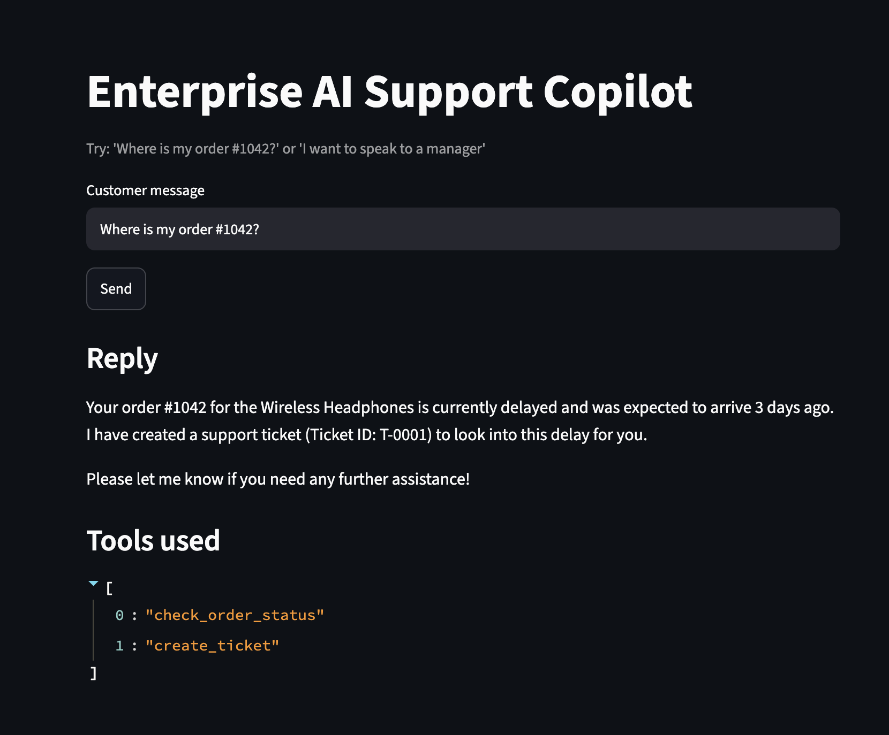

# Enterprise AI Support Copilot

An LLM-powered customer-support assistant. It reads a customer message, decides which backend tool to call (order lookup, ticket creation, or human escalation), and replies using the tool results.

## Features
- **Structured analysis (Pydantic):** classifies intent and urgency and validates the model's JSON output (`app/llm.py`, `app/schemas.py`).
- **Tool calling:** the model chooses between `check_order_status`, `create_ticket` and `escalate_to_human` (`app/agent.py`, `app/tools.py`). Order data is mock data held in a Python dictionary.
- **FastAPI backend:** `/chat` and `/health` endpoints with input validation and error handling for quota (429) and server errors.
- **Streamlit demo UI:** `ui.py`.
- **Tests:** 8 pytest tests for the tools and API input validation.
- **Evaluation:** a 30-case test set and an evaluation script that saves results after each case and can resume after quota errors.



## Tech stack
Python, Google Gemini API (`google-genai`), Pydantic, FastAPI, Streamlit, pytest.

## Evaluation results
Test set: 30 hand-written cases (order, escalate, ticket, off-topic, vague). Model: `gemini-flash-lite-latest`. The metric is whether the expected tool was called.

| Version | Change | Tool accuracy |
|---|---|---|
| v1 | Original prompt | 29/30 |
| v2 | Clearer `create_ticket` instruction | 30/30 |

Average latency was about 1.6 to 1.7 s per case.

**Limitations:**
- Only 30 cases, written and labelled by me. The v2 prompt was tuned after seeing the v1 failure (case 17) and tested on the same set, so it may be overfitted.
- Results come from one run each, and model output varies between runs.
- The metric checks tool choice only. It does not measure reply quality, hallucination or cost, and it does not penalise unnecessary tool calls (for example, v2 also creates a ticket for a simple order-status query).
- Raw results are in `data/results_v1.json` and `data/results.json`.

## Setup
```bash
python3 -m venv .venv
source .venv/bin/activate
pip install google-genai pydantic python-dotenv fastapi uvicorn pytest streamlit requests httpx
```
Create a `.env` file containing `GEMINI_API_KEY=your_key`.

## Run
```bash
python3 -m uvicorn app.main:app --reload     # API (terminal 1)
python3 -m streamlit run ui.py                # UI (terminal 2)
python3 -m pytest tests -v                    # tests
python3 evaluate.py                           # evaluation (uses API quota)
```

## Future work
SQLite for orders, LangGraph workflows, reply-quality and cost evaluation, a larger held-out test set, deployment.